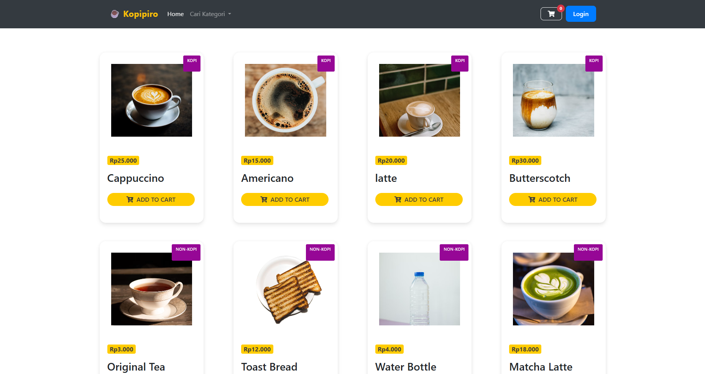

# Kopipiro ☕

Website pemesanan kopi berbasis PHP dan MySQL dengan fitur pengelolaan produk, keranjang belanja, pemesanan, dan dashboard admin serta kasir.

## Preview



## Features

- **Landing Page** — Tampilan katalog produk kopi dan non-kopi.
- **Shopping Cart** — Menambahkan, mengurangi, dan menghapus produk dari keranjang.
- **User Authentication** — Login dan pengelolaan akses berdasarkan peran.
- **Admin Dashboard** — Mengelola produk dan melihat data pesanan serta penjualan.
- **Cashier Dashboard** — Melihat pesanan dan memperbarui status pelayanan.
- **Sales Chart** — Visualisasi penjualan harian.
- **Excel Export** — Mengunduh data pesanan dalam format `.xlsx`.

## Tech Stack

- PHP
- MySQL
- HTML, CSS, JavaScript
- Bootstrap 4
- Chart.js

## Installation

1. Clone repository:

   ```bash
   git clone <repository-url>
   ```

2. Pindahkan project ke direktori web server, misalnya `htdocs` jika menggunakan XAMPP.

3. Buat database MySQL dan impor file SQL database yang tersedia.

4. Sesuaikan konfigurasi database pada `config.php`.

5. Jalankan Apache dan MySQL melalui XAMPP atau Laragon.

6. Buka project melalui browser:

   ```text
   http://localhost/<project-folder>/
   ```

---

Made with ☕
